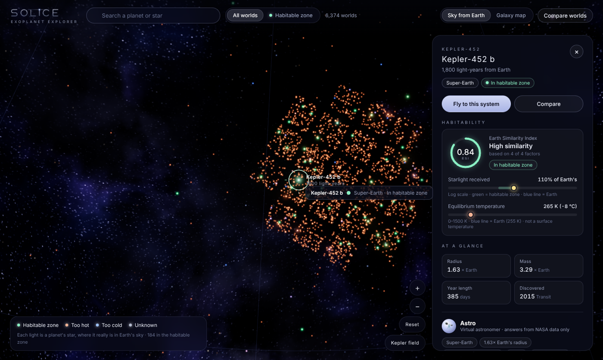
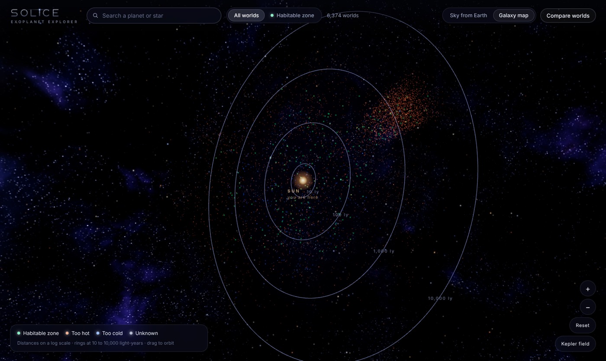
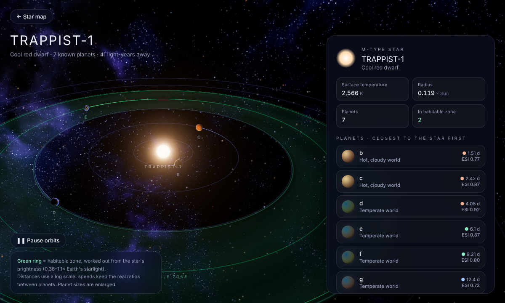
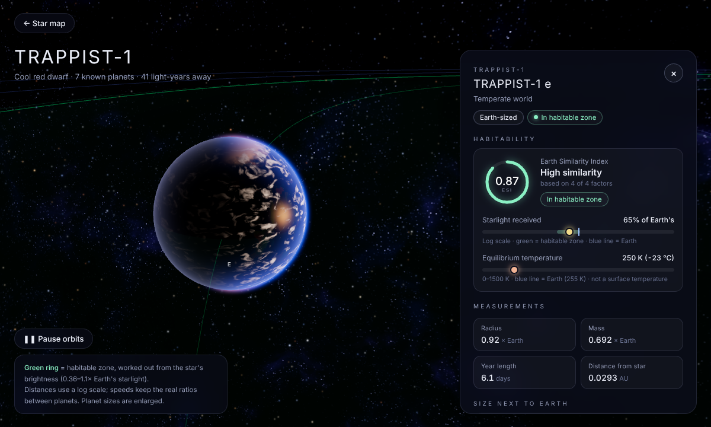
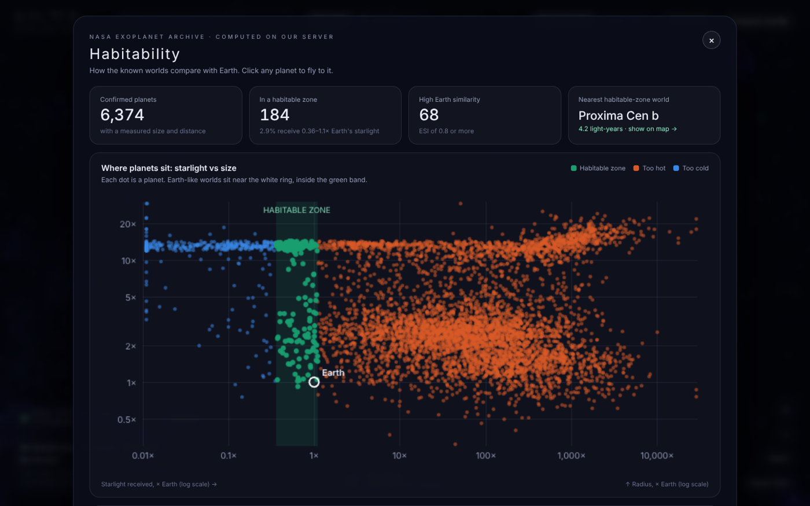
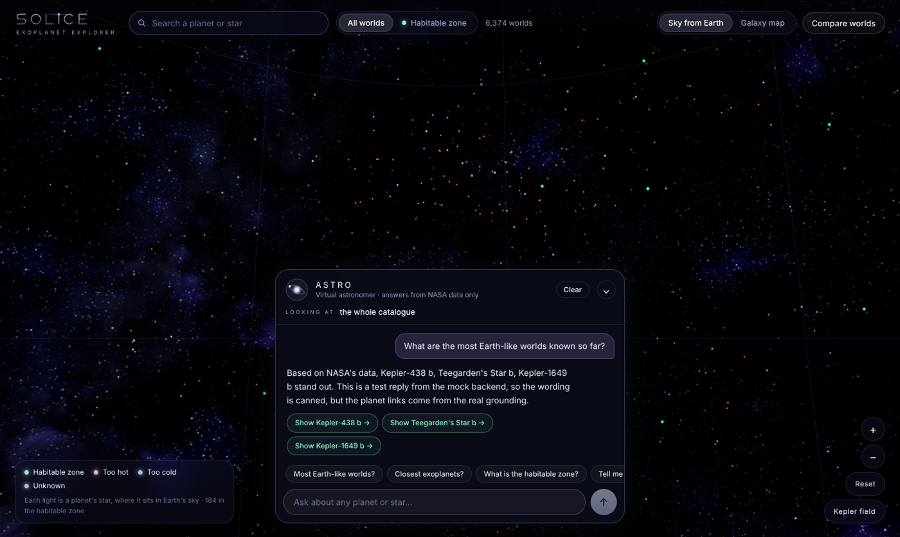
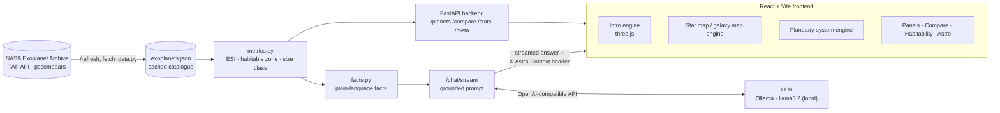

# SOLICE: Explore the worlds beyond our Sun

> An AI-powered 3D exoplanet explorer built on live data from NASA's Exoplanet Archive.
> CBIT Hacktoberfest '26 · Team **lumbar** · `HFT26-TEAM-64`



**🎥 Demo video:** [_solice_ ](https://drive.google.com/file/d/1GizD4khv7UuYTV6QtFAFuciFpTSeOY8f/view?usp=sharing)· **Track:** AI-Powered 3D Exoplanet Explorer

---

## 📋 Team Information

| Attribute | Details |
| :--- | :--- |
| **Team Name** | **lumbar** |
| **Team Number** | `TEAM-64` (`HFT26-TEAM-64`) |
| **Registration ID** | `HFEST26-TR55U7RX` |
| **Problem Track** | **An AI-Powered 3D Exoplanet Explorer** |
| **Domain** | `General Track` |
| **Team Leader** | Rhuthvija A (rhuthvija12@gmail.com) |
| **Institution** | CBIT Hyderabad |

### 👥 Team Members

| # | Name | GitHub | Email | Institution |
| :--- | :--- | :--- | :--- | :--- |
| 1 | Rhuthvija A (Team Leader) | [@Rhuthvija](https://github.com/Rhuthvija) | rhuthvija12@gmail.com | CBIT Hyderabad |
| 2 | Shraddha | [@shraddha-reddy](https://github.com/shraddha-reddy) | shraddhareddy0249@gmail.com | CBIT Hyderabad |
| 3 | Medhashri | [@Medhashri24](https://github.com/Medhashri24) | medhashridande@gmail.com | CBIT Hyderabad |

---

## 🎯 Problem Statement

Exoplanets are planets outside our solar system, but raw scientific data makes it hard to understand their properties
and whether they could be habitable. The challenge: build an interactive 3D platform to explore known exoplanets,
visualise their planetary systems, and use AI to explain and compare them.

| Requirement | How SOLICE meets it |
| :--- | :--- |
| 1. Interactive 3D visualisation of known exoplanets | WebGL star map of all 6,000+ planets at their real sky positions, a 3D galaxy map, and a 3D view of every planetary system |
| 2. Planetary properties (size, distance, orbital period) | Planet panels with radius, mass, year length, distance from star and from Earth, star type and discovery details |
| 3. Real data from NASA's Exoplanet Archive | Backend pulls the `pscomppars` table from NASA's TAP API; a **Sync** button refreshes it live and reports new planets |
| 4. AI explanations and comparisons | **Astro**, a virtual astronomer grounded in NASA data, plus a side-by-side **Compare worlds** view with an AI summary |
| 5. Habitability indicators | Earth Similarity Index (ESI), habitable-zone status, starlight and temperature gauges, and a catalogue-wide **Habitability** dashboard |
| 6. Simple, user-friendly interface | One consistent design, search, a one-click habitable-zone filter, and plain-language labels everywhere |

---

## 📌 Solution Overview

**Cinematic intro.** A WebGL journey from deep space into the Milky Way, a warp to the Orion Arm, past Earth, and out
to the Solar System, ending on the SOLICE title and *Enter the Universe*.

**Star map.** Every confirmed exoplanet's star, placed where it really is in Earth's sky (RA / Dec) and coloured by
habitable-zone status. Switch to **Galaxy map** and every planet flies to its real 3D position around the Sun
(log-scale distance), inside the true plane of the Milky Way. The Kepler telescope's field shows up as a dense cone of
discoveries.

**Planetary systems.** *Fly to this system* dives into any star. Orbits use each planet's real distance (log scale) and
real period ratios; the **habitable zone is computed from the star's brightness**. Planet appearance is generated from
size and temperature (hot Jupiters, lava worlds, ice giants, temperate rocky worlds) and is clearly labelled as
illustrative. Click a planet to fly to it and see its habitability readout.

**Astro, the virtual astronomer.** A floating assistant that knows what you're looking at (the whole catalogue, a
system, or one planet). Every planet it mentions becomes a *Show →* link that flies the 3D view there.

**Habitability dashboard.** Headline numbers, a starlight-vs-size map of every planet with the habitable zone and Earth
marked, and the most Earth-like worlds ranked by ESI.

| | |
| :---: | :---: |
|  |  |
| **Galaxy map:** real 3D positions, log distance | **System view:** TRAPPIST-1 and its habitable zone |
|  |  |
| **Planet close-up:** TRAPPIST-1 e | **Habitability dashboard** |



---

## 🏗️ Architecture



**How the AI stays accurate.** The language model never calculates anything and never answers from memory.
`metrics.py` computes every number (ESI, habitable zone, starlight); `facts.py` turns them into plain sentences; and
the backend puts only those facts into the prompt, with strict rules (use only these facts, say "NASA's data doesn't
tell us that" otherwise, never speculate about life). Planets named in a question, and catalogue-wide facts for
questions like "which planets are closest?", are added automatically. The response header lists exactly which planets
the answer was grounded on, and only those become clickable links.

**How the 3D stays smooth.** Plain three.js engines (no per-frame React re-renders). Planet surfaces, clouds and the
nebula sky are generated once on the GPU into textures, then reused every frame. The renderer cleans invalid pixels
before the glow pass, steps down to simpler rendering if a GPU outputs black frames, and lowers the resolution if the
frame rate drops.

### Habitability metrics

- **Habitable zone:** a planet is *in* the zone if it receives **0.36–1.1×** the starlight Earth gets
  (`pl_insol`, or estimated from the star's radius, temperature and the orbit size). In the system view the zone is
  drawn from the star's luminosity, L = R² (T / 5772 K)⁴.
- **Earth Similarity Index (ESI):** the weighted geometric similarity to Earth in radius, density, escape velocity and
  equilibrium temperature (Schulze-Makuch et al., 2011). 1.0 = identical to Earth. When mass is unknown, it uses radius
  and temperature only, and the UI says so.
- Neither metric means life exists. They show which worlds are most Earth-like by the numbers, and the app says so.

### Tech stack

| Layer | Tools |
| :--- | :--- |
| Frontend | React 19, Vite, three.js (WebGL, custom GLSL shaders, UnrealBloom post-processing) |
| Backend | Python, FastAPI, Uvicorn, Requests |
| AI | Any OpenAI-compatible LLM via the `openai` client: Ollama + llama3.2 by default (Featherless, Gemini and Claude also work) |
| Data | NASA Exoplanet Archive TAP API, `pscomppars` table |

---

## 📁 Project Structure

```
.
├── src/
│   ├── backend/
│   │   ├── main.py            # API: planets, compare, stats, meta, refresh, grounded chat
│   │   ├── metrics.py         # ESI, habitable zone, size class (pure calculations)
│   │   ├── facts.py           # plain-language facts given to the AI
│   │   ├── fetch_data.py      # one-off download from NASA
│   │   ├── exoplanets.json    # cached NASA catalogue
│   │   └── requirements.txt
│   └── frontend/
│       ├── index.html
│       └── src/
│           ├── App.jsx                 # layout, data loading, view switching
│           ├── Intro.jsx, intro/       # cinematic intro (engine + shaders)
│           ├── space/                  # 3D engines: star map, galaxy map, planetary systems
│           ├── StarMapView.jsx, SystemView.jsx
│           ├── Astro.jsx               # virtual astronomer
│           ├── Panel.jsx, Gauges.jsx, CompareView.jsx
│           ├── HabitabilityView.jsx, DataBadge.jsx
│           └── App.css                 # design system
├── docs/screenshots/
├── README.md
└── LICENSE
```

---

## 🚀 Local Setup

**Requirements:** Python 3.10+, Node.js 20+, and [Ollama](https://ollama.com) for the AI astronomer.

**1. Backend** (terminal 1)

```bash
cd src/backend
python3 -m venv venv
source venv/bin/activate            # Windows: venv\Scripts\activate
pip install -r requirements.txt
ollama pull llama3.2
uvicorn main:app --reload
```

The API runs at http://127.0.0.1:8000 (interactive docs at `/docs`). The NASA catalogue is already cached in
`exoplanets.json`; use the **Sync** button in the app (or `POST /refresh`) to pull the latest from NASA.

**2. Frontend** (terminal 2)

```bash
cd src/frontend
npm install
npm run dev
```

Open http://localhost:5173.

**Optional: AI provider.** Create `src/backend/.env` to use a different OpenAI-compatible model:

```
LLM_BASE_URL=http://localhost:11434/v1     # default: local Ollama
LLM_API_KEY=ollama
LLM_MODEL=llama3.2
```

### Using it

| Action | How |
| :--- | :--- |
| Skip the intro | **Skip intro**, or open `localhost:5173/?nointro` |
| Look around / zoom | Drag; scroll or pinch; **+ / −** buttons |
| Pick a planet | Click a light (green = habitable zone) |
| Visit its system | **Fly to this system**; click planets to fly to them; `Space` pauses orbits; `Esc` goes back |
| 3D galaxy map | **Galaxy map** toggle in the top bar |
| Ask Astro | Bottom-centre button, or press `/` |
| Compare two worlds | **Compare worlds** |
| Habitability overview | **Habitability** |
| Pull the latest NASA data | **Sync** (bottom left) |
| GPU trouble | `?intro=safe` or `?intro=basic` forces simpler rendering |

---

## ⚠️ Honest limitations

- Exoplanet surfaces have never been photographed. Planet looks are generated from size and temperature and are labelled as illustrative.
- Distances in the system and galaxy views use log scales so that tight and huge systems both stay readable; the app states this on screen.
- Equilibrium temperature is not surface temperature; the UI and the AI both say so.
- With local Ollama, the AI astronomer runs on the presenter's machine, so the demo video shows it live.

---

## 🙏 Data & attributions

- This research has made use of the **NASA Exoplanet Archive**, which is operated by the California Institute of
  Technology, under contract with the National Aeronautics and Space Administration under the Exoplanet Exploration
  Program.
- Earth Similarity Index: Schulze-Makuch, D. et al. (2011), *Astrobiology* 11(10).
- Open-source libraries: [three.js](https://threejs.org) (MIT), [React](https://react.dev) (MIT), [Vite](https://vitejs.dev) (MIT),
  [FastAPI](https://fastapi.tiangolo.com) (MIT), [Ollama](https://ollama.com) (MIT), Meta Llama 3.2 (Llama 3.2 Community License).
- 3D simplex noise in the shaders: Ashima Arts / Stefan Gustavson (MIT).
- Fonts: Michroma and Inter, from Google Fonts (SIL Open Font License).

## 📄 License

MIT. See [LICENSE](LICENSE).
